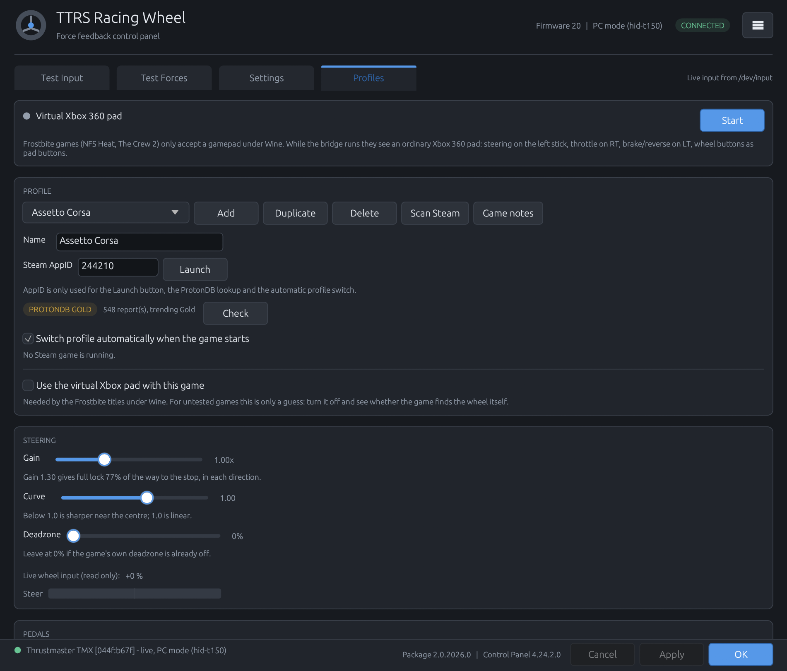

# TMX/T150 Control Panel

A Linux control panel for the **Thrustmaster TMX / T150** racing wheels,
reimplementing the look and behaviour of the Windows vendor panel, plus the
pieces a wheel needs to be usable on Linux: force feedback, per-game profiles
and a virtual gamepad for games that refuse to see a wheel under Wine/Proton.



## What it does

**Test Input** — live steering, three pedal bars, rim buttons and a POV hat,
read straight from `/dev/input`.

**Test Forces** — twelve force feedback effects played on the wheel through
evdev (engine rumble, blown tyre, kerbs, and so on).

**Settings** — wheel rotation (40–1080°, 900° on the TMX/T150), overall gain,
per-effect gains, auto-centre, LED intensity and the drive mode. These are
written to the `hid-t150` sysfs attributes, so they survive as long as the
module is loaded.

**Profiles** — one tuning block per game:

* steering gain, response curve and deadzone for the virtual pad
* wheel rotation and overall gain, written to the wheel when the profile becomes active
* a per-button remap of all 13 wheel buttons
* a Steam AppID, so the profile can be launched and switched to automatically
  when that game starts
* a **ProtonDB** verdict badge (Platinum … Borked), cached for a day
* a switch for the virtual pad, because some games need it and some do not

**Scan Steam** walks `libraryfolders.vdf` and `appmanifest_*.acf`, finds the
installed racing titles and adds a profile for each one that does not have one
yet. Suggestions for seven games come from Brian Koponen's TMX/T150 guides;
the source is shown next to each value.

**Game Bridge** — for Frostbite titles (Need for Speed Heat, The Crew 2) which
only accept a gamepad under Wine. The bridge reads the wheel and publishes it
as an ordinary Xbox 360 pad through `/dev/uinput`, so steering, pedals and
buttons arrive as a normal controller.

**Theme and scale** — System / Light / Dark and 100–150 % UI zoom, reachable
from the ☰ menu in the header.

## Requirements

* Linux with evdev (`/dev/input`, `/dev/uinput` for the bridge)
* Rust stable (edition 2021) to build
* `hid-t150` kernel module for wheel settings and force feedback — see
  [driver/t150/README.md](driver/t150/README.md)
* Optional: Steam (profiles and the automatic switch), `curl` (ProtonDB lookup)

The wheel must be in **PC mode** (`044f:b677` for the T150, `044f:b67f` for the
TMX). In Xbox/GIP mode (`044f:b67e`) the kernel's `xpad` driver takes it over
and the panel can only show simulated input.

## Build and run

```sh
cargo build --release
./target/release/tmx-t150-panel
```

Command line helpers:

```sh
tmx-t150-panel --scan              # list racing games found in the Steam libraries
tmx-t150-panel --protondb 1222680  # print the ProtonDB verdict for an AppID
tmx-t150-panel --bridge-check      # create the virtual pad for a moment and report
tmx-t150-panel --tmx-switch        # send the Xbox-to-PC mode command (needs root)
tmx-t150-panel --theme dark        # force a theme for one run
```

## Install

### Prebuilt package

Download the tarball for your architecture from the
[releases page](https://github.com/reiokr/tmx-t150-panel/releases):

```sh
tar xzf tmx-t150-panel-*.tar.gz
cd tmx-t150-panel-*/
./install.sh              # this user; use --system for all users
```

It installs the binary into `~/.local/bin`, writes the menu entry and the icon;
`uninstall.sh` removes them again and leaves the settings alone. The package is
built on Debian bookworm, so it needs glibc 2.36 or newer (Debian 12, Ubuntu
22.04 and anything more recent). On an older system, build from source.

### From a source checkout

```sh
cargo build --release
desktop/install.sh        # menu entry, this user; --system for all users
```

The wizard inside the application only shows the language and the licence
notice — it installs nothing, by design. Installation is the script.

## Kernel driver

```sh
cd driver/t150
sudo ./install.sh
```

This builds `hid-t150` with DKMS for the running kernel, installs the udev rule
and reloads. Reconnect the wheel afterwards. Check with:

```sh
dmesg | tail -20
ls /sys/bus/hid/devices/*/range
```

## Steam launch option for bridged games

Games marked **NEEDS BRIDGE** in the Game notes window need the wheel hidden
from their own input stack:

```
SDL_GAMECONTROLLER_IGNORE_DEVICES=0x044f/0xb67f %command%
```

Substitute the VID/PID of your wheel (`b67f` = TMX, `b677` = T150). The panel
generates the exact line for the connected wheel.

## Files written

| Path | Contents |
|---|---|
| `~/.config/tmx-t150-panel/profiles.conf` | game profiles |
| `~/.config/tmx-t150-panel/ui.conf` | theme and UI scale |
| `~/.config/tmx-t150-panel/protondb.cache` | ProtonDB verdicts, 24 h |

A menu entry is created only by `desktop/install.sh`. Game files are edited
only when you explicitly apply a change, and a backup is kept next to the
original.

## Known limitations

* **The Crew 2 does not run under Proton.** BattlEye cannot load its kernel
  driver (`Driver Load Error 1053`, reported as *borked* on ProtonDB). Nothing
  in this project can change that.
* Steam's "Verify integrity of game files" restores any game file this project
  helped you change.
* The TMX/T150 are 900° wheels; the panel clamps rotation accordingly.
* `hid-t150` is out-of-tree: a kernel upgrade needs the module rebuilt
  (`sudo dkms autoinstall`).

## How this was written

The code was written by an AI coding agent, not by hand. The model is
**DeepSeek V4.1 Flash** (through OpenCode, provider `opencode-go`). The person
who started the project set the requirements, tested everything on real hardware
(a Thrustmaster TMX) and reviewed the result. Earlier iterations of the project
came from previous agent sessions with the same tooling; their exact model is
not recorded.

The user interface follows the layout of the Windows vendor panel, but the
implementation, the profile system, the Steam scanner, the ProtonDB lookup and
the virtual pad are new code written for this project.

## Licence

The application is MIT licensed — see [LICENSE](LICENSE). The kernel module in
`driver/t150/` is a separate program under GPL-2.0 — see
[driver/t150/LICENSE](driver/t150/LICENSE) — and is not covered by the MIT
licence. Trademark and third-party notices are in [NOTICE](NOTICE).
